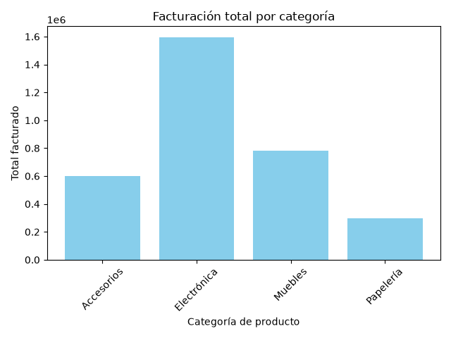

# Sales Analysis & Inventory System

A Python project that stores sales data in SQLite, cleans and analyzes it
with Pandas and NumPy, and generates a revenue chart with Matplotlib.

## What it does
- Creates a SQLite database with `Productos` and `Ventas` tables and loads sample data
- Reads the tables into Pandas DataFrames and merges them by `id_producto`
- Removes duplicates and null values, and calculates `total_venta`
- Computes total revenue and the mean, median and standard deviation of units sold
- Exports a bar chart of revenue by category as a PNG

## Tech stack
Python, SQLite3, Pandas, NumPy, Matplotlib

## How to run
    pip install -r requirements.txt
    python sistemadeventas.py

## Result

## Context
University project (CAECE) built to practice data persistence,
data cleaning and visualization in Python.
